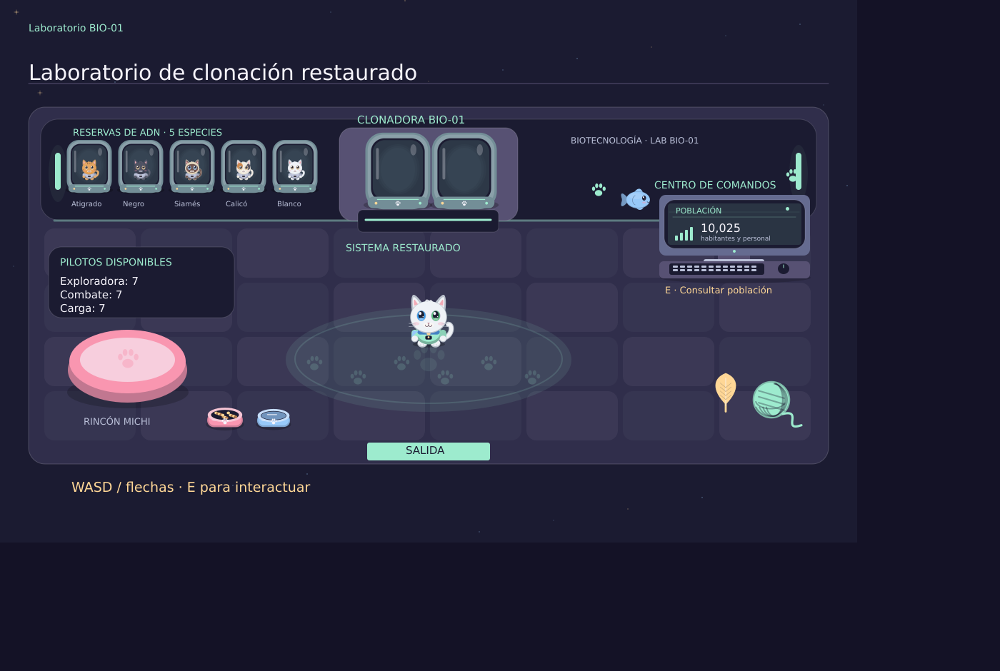
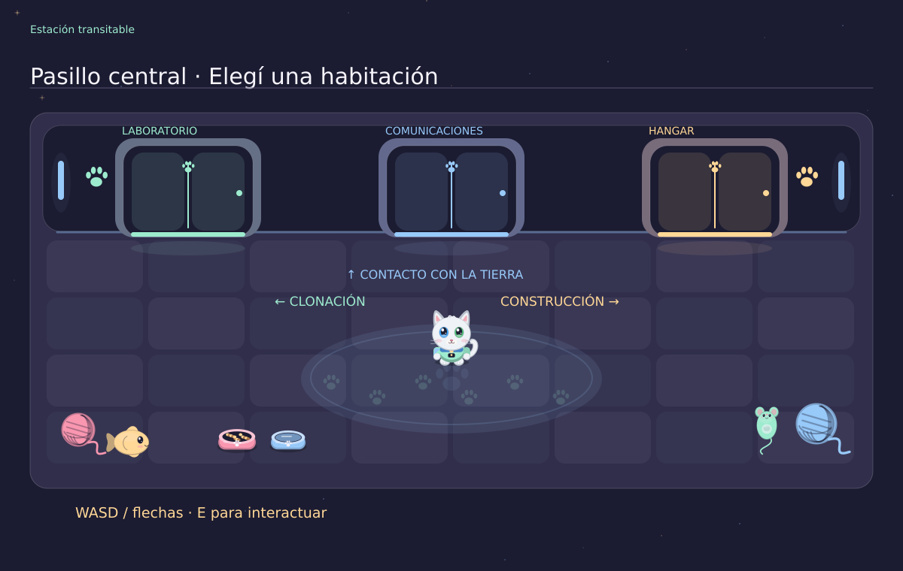
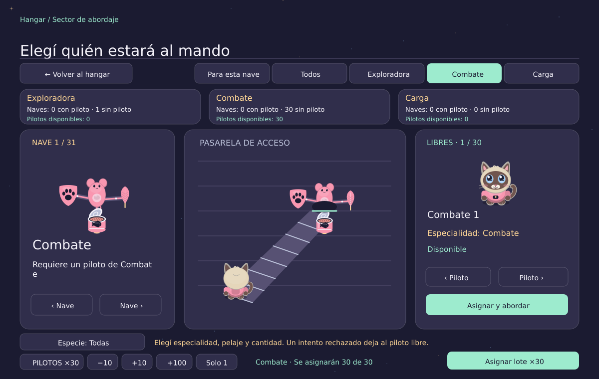

# Kepler-7 · Operación Bigotes

Videojuego de escritorio en **C# y Windows Forms**, ambientado en una estación espacial de gatos. Rescatá la clonadora, reuní a tu tripulación, construí naves y prepará su lanzamiento.

Esta versión implementa **Builder, Prototype, Flyweight y Bridge: 4 de los 12 patrones** del trabajo práctico. Es una entrega en desarrollo.

## 1. Jugar

1. Extraé **todo el ZIP** en una carpeta.
2. Abrí **Jugar.cmd** con doble clic.
3. Elegí **Comenzar misión**, o **Continuar** si ya tenés progreso guardado.

No ejecutes el juego dentro del ZIP ni muevas archivos sueltos de `Juego`. El lanzador encuentra el runtime incluido; abrir `Juego/Kepler7.exe` directamente puede pedir una instalación de .NET.

### Requisitos para jugar

| Requisito | Detalle |
|---|---|
| Sistema | Windows x64 compatible con .NET 8 y Windows Forms. Esta distribución no está preparada para Linux o macOS. |
| Teclado y mouse | Necesarios para moverse, apuntar y arrastrar piezas. |
| Pantalla | Se recomienda 1280 × 800 o más. La ventana tiene un tamaño mínimo de 960 × 640; el escalado de Windows puede requerir más espacio. |
| Disco | Reservar aproximadamente 200 MB para la carpeta extraída, más espacio para el guardado. |
| .NET | Incluye Microsoft.NETCore.App y Microsoft.WindowsDesktop.App 8.0.15, usados por `Jugar.cmd`. |
| Internet | No se necesita para jugar. |
| Visual Studio | No se necesita para jugar. |
| Sonido | Opcional. Incluye música de emergencia, alarma y bufido. |

No se estableció un mínimo de RAM o procesador mediante pruebas de rendimiento.

## 2. Objetivo y recorrido

1. **Rescate:** eliminá a los 15 mutantes y repará la clonadora antes de que se terminen los **dos minutos**. El tiempo es compartido entre combate y reparación. Los botiquines brillantes recuperan salud.
2. **Reparación:** arrastrá las piezas faltantes, girá los tornillos con el mouse y uní los cables por color y número.
3. **Clonación:** creá al Ingeniero Jefe para desbloquear el hangar. Después creá pilotos de Exploradora, Combate y Carga, eligiendo nombre, pelaje y remera.
4. **Ensamblaje:** arrastrá las piezas que coincidan en componente, forma y color con el modelo. Un fallo cancela el armado y resta una de las tres vidas del taller. Podés reintentar sin perder tu flota.
5. **Abordaje:** elegí una nave y un piloto de su especialidad. Si son compatibles, el gato sube a la nave; si no, bufa y la asignación se rechaza.
6. **Lanzamiento:** necesitás al menos una nave de cada tipo con su piloto compatible. Después podés seguir creando naves y pilotos.

7. **Comunicaciones:** entrá por la puerta central del pasillo. Arrastrá los tres reguladores hasta alinear las ondas y mantené la señal estable. El informe y su tipo dependen de tu avance: amenaza contenida, ingeniero operativo, primera nave, flota preparada o despegue. Elegí el cifrado y enviá el informe a la Tierra. Cada etapa tiene su propia respuesta. Es una simulación local, sin conexión a Internet.

Las ayudas aparecen al entrar por primera vez a cada sector. **F1** permite volver a consultarlas. Hay varias pantallas de ayuda distribuidas a lo largo del recorrido.

La misión de rescate termina en derrota si se agota el tiempo o la salud. Al resolverla recibís una medalla de bronce, plata u oro según tu tiempo. Al bajar de 15 segundos se activan la alarma y los pulsos rojos.

Cada informe de historia se envía una sola vez. Después del envío se reinician las antenas y su estabilidad; el próximo informe se prepara cuando avanzás en la misión. Si no hay novedades, la pantalla indica el objetivo que sigue. Si cargás una partida avanzada, se informa la etapa actual sin exigir avisos atrasados. El historial conserva los mensajes y las respuestas de la Tierra.

## 3. Controles

| Acción | Control |
|---|---|
| Mover al personaje | WASD o flechas |
| Entrar o salir de una habitación | Caminar hacia la puerta |
| Usar clonadora, mesa o terminal de población | Acercarse y presionar E |
| Abrir el sector de abordaje | Caminar hacia la puerta «SECTOR ABORDAJE», a la derecha del hangar (requiere una nave construida) |
| Apuntar en combate | Mover el mouse |
| Disparar | Mantener clic izquierdo o Espacio |
| Mover piezas o conectar cables | Arrastrar con clic izquierdo |
| Ajustar tornillos | Mantener clic y girar en sentido horario alrededor del tornillo |
| Pausar durante la emergencia | P; Esc también pausa el combate |
| Cerrar un panel | Esc o su botón Volver |
| Consultar ayuda | F1 o Ayuda |
| Silenciar/reactivar música | M; la alarma crítica se mantiene |

Las ayudas, la pausa, el menú y perder el foco de la ventana detienen el reloj de emergencia.

## 4. Lotes, población y filtros

- **Clonación:** permite crear un piloto o múltiplos de diez, hasta 10.000 por lote. Podés escribir la cantidad o usar los controles del panel.
- **Ensamblaje:** elegí la cantidad con −10, +10, +100 o Solo 1. Armá correctamente el modelo una vez para fabricar el lote de copias independientes. Al terminar la animación, las naves pasan a la flota y **la mesa queda vacía**.
- **Abordaje:** filtrá por Exploradora, Combate, Carga, Todos o Para esta nave. La lista muestra solamente pilotos disponibles. Podés filtrar también por especie y tocar **PILOTOS ×cantidad** para escribir un número exacto de 1 a 10.000. Antes de confirmar ves cuántos se asignarán. Con 30 pilotos libres y 30 naves compatibles, el lote de 30 asigna los 30. La asignación respeta especialidad y pelaje; si faltan pilotos o naves, completa hasta la cantidad disponible. Un intento individual rechazado deja al piloto libre.
- **Contadores de abordaje:** cada especialidad muestra naves con piloto, naves sin piloto y pilotos disponibles. Se actualizan al asignar y permiten verificar el resultado de cada lote. Un piloto no puede ocupar dos naves.
- **Control de población:** se abre en la terminal derecha del laboratorio. El botón **Habitantes** reúne solamente a los 10.000 habitantes fundacionales. **Tripulantes** muestra al ingeniero y otros roles no pilotos. Los pilotos tienen sus propios filtros. **Todos** muestra el conjunto. Las estadísticas cambian con el filtro seleccionado.
- **Flyweight:** el botón **Con Flyweight / Sin Flyweight** compara el grupo que coincide con los filtros activos con una copia temporal sin compartir especies. Los botones de grupo, la especie y la búsqueda actualizan los objetos compartidos, los objetos sin compartir y la reducción. El total de la estación se muestra separado arriba. Esa copia no se suma a la población. Recuperar el censo entrega una insignia y 100 XP una sola vez.

Los lotes tienen un máximo de 10.000 por operación. No hay un límite total fijado para naves o pilotos, aunque la capacidad práctica depende del equipo y del tamaño del guardado.

### Búsquedas y bitácora

Los botones **Exploradora**, **Combate**, **Carga**, **Tripulantes** (personal no piloto) y **Habitantes** separan los grupos. **Todos** y **Disponibles** permiten consultar el conjunto o los pilotos libres. Elegir un grupo limpia los filtros anteriores; **Limpiar filtros** conserva el grupo y quita la especie y la búsqueda.

En población y en la biblioteca podés buscar por nombre o identificador, filtrar por especie dentro de cada grupo, y tocar el número de página para saltar directamente. En población también podés separar libres y asignados.

El botón **Logros** muestra las cuatro insignias disponibles y permite consultar los últimos veinte resúmenes de operaciones. Los lotes muestran su resultado al terminar; los carteles del laboratorio y del hangar indican pilotos disponibles y naves que esperan piloto por especialidad.

## 5. Guardado

El progreso se guarda automáticamente en:

```text
%AppData%\Kepler7\prototipo-gatitos.json
```

Para encontrarlo, pegá `%AppData%\Kepler7` en el Explorador de archivos.

Se conservan la reparación completada, el ingeniero, los pilotos, las naves y sus piezas, las asignaciones, XP, lanzamiento, ayudas vistas, medalla de rescate, insignias Flyweight y Bridge, transmisiones completadas y los últimos veinte resúmenes de operaciones. Las asignaciones se guardan al comenzar el abordaje.

Los 10.000 habitantes fundacionales son un registro de consulta: se reconstruyen al cargar con los mismos nombres, identificadores, rangos y especies. No son pilotos disponibles.

**No se guarda** el combate en curso, el tiempo restante, la reparación parcial, el modelo o armado pendientes ni las vidas restantes del taller. Si cerrás antes de completar el rescate, esa misión vuelve a empezar. Nueva partida pide confirmación cuando hay progreso para reemplazar.

## 6. Código y bibliotecas

| Carpeta o archivo | Contenido |
|---|---|
| `Kepler7.sln` | Solución para Visual Studio. |
| `Kepler7.Core` | Patrones, reglas del juego, población y guardado. No depende de Windows Forms. |
| `Kepler7.Game` | Ventanas, dibujos, controles, sonido y animaciones con Timer. |
| `Kepler7.Checks` | Comprobaciones automatizadas de consola, sin frameworks de terceros. |
| `Juego` | Ejecutable, audio y runtime de Microsoft incluido. |
| `docs/capturas` | Imágenes del juego incluidas en este README. |

Se utilizan bibliotecas incluidas en .NET: `System.Windows.Forms`, `System.Drawing`, `System.Drawing.Drawing2D`, `System.Numerics`, `System.Text.Json`, `System.Media`, `System.Security.Cryptography`, `System.Text`, `System.IO`, `System.Linq` y colecciones de `System.Collections.Generic`.

Los proyectos no declaran paquetes NuGet de terceros. No se usan motores de videojuegos ni frameworks gráficos externos. El runtime incluido es de Microsoft; su licencia está en `Juego/runtime/LICENSE.txt`.

### Patrones implementados

| Patrón | Implementación y dónde se observa |
|---|---|
| **Builder** | `Nave`, `INaveBuilder`, `NaveBuilder` y el director `IngenieroJefe`. Las recetas Exploradora, Combate y Carga se construyen en el hangar y su resultado se ve en la flota. |
| **Prototype** | `Tripulante` implementa `IPrototipo.Clonar()`. Copia habilidades, uniforme, aspecto y marcas sin modificar el original. La clonadora muestra la matriz de origen y la vista previa del nuevo tripulante. |
| **Flyweight** | `IEspecie` contiene los datos inmutables compartidos. `FabricaEspecies` utiliza un diccionario y crea cinco especies para 10.000 habitantes. El censo permite comparar cinco objetos de especie frente a un objeto por persona sin compartir. |

| **Bridge** | `Mensaje` y sus variantes Texto, Alerta y Emergencia utilizan `ICifrado`: SinCifrado, AES o Cuántico simulado. Podés cambiar el cifrado sin cambiar el tipo de mensaje. El avance de la historia determina la variante de mensaje y el jugador puede cambiar su cifrado. Las nueve combinaciones se verifican en la lógica. |

AES utiliza la implementación de .NET y un IV aleatorio por mensaje. La opción cuántica es una **simulación educativa**, no criptografía cuántica real. El historial conserva también el mensaje recibido en texto claro para poder consultarlo; no es una herramienta para proteger secretos. La insignia Bridge se obtiene al restablecer el contacto con un informe de misión y entrega 150 XP una sola vez. Las insignias y transmisiones de versiones anteriores se conservan.

El porcentaje se recalcula al cambiar los filtros y se muestra con cuatro decimales. Treinta gatos de una especie comparan 1 objeto compartido frente a 30 sin compartir: 96,6667 % de reducción. Sin resultados, ambos contadores muestran cero y el porcentaje muestra un guion. Cambiar de página no cambia los totales del grupo. Corresponde a la reducción de **objetos de especie**, no a un porcentaje medido de memoria total o velocidad. Prototype comparte la especie inmutable y copia los datos modificables de cada gato. Crear diez clones agrega diez personas; no agrega diez especies. Al volver a abrir la biblioteca se actualiza el censo completo y la comparación sin Flyweight, mientras la estación sigue compartiendo cinco especies; el grupo filtrado utiliza sólo las que aparecen entre sus resultados.

## 7. Compilar y ejecutar las comprobaciones

Para desarrollar necesitás **Windows, SDK de .NET 8** y, si usás Visual Studio, la carga de trabajo **Desarrollo de escritorio de .NET**. Puede hacer falta Internet para instalar el SDK o restaurar los componentes oficiales de compilación.

Abrí `Kepler7.sln` y seleccioná `Kepler7.Game` como proyecto de inicio. También podés ejecutar estos comandos desde la carpeta que contiene la solución:

```powershell
dotnet build Kepler7.sln -c Release
dotnet run --project Kepler7.Game -c Release
dotnet run --project Kepler7.Checks -c Release
```

Podés ejecutar **GenerarRelease.cmd** en Windows: primero comprueba la lógica y después publica en `Publicado`. Para generar manualmente una distribución Windows x64 que incluya su runtime:

```powershell
dotnet publish Kepler7.Game -c Release -r win-x64 --self-contained true -o Publicado
```

En esa distribución, ejecutá `Publicado/Kepler7.exe` y conservá todos los archivos publicados. Editar el código no actualiza automáticamente la carpeta `Juego` del ZIP: hay que recompilar o publicar.

## 8. Capturas y vistas previas

### Laboratorio: reservas de ADN y centro de comandos



### Pasillo central



### Asignación de pilotos



Estas vistas se generaron con el código de dibujo y un renderizador auxiliar. No son capturas nativas de Windows. Para la entrega final, deben reemplazarse por capturas de la versión definitiva ejecutándose en Windows.

## 9. Estado de verificación y pendientes de entrega

La lógica cuenta con **211 verificaciones automatizadas de lógica aprobadas**, incluyendo clonación profunda, recetas, lotes, asignaciones, guardado, población, insignias y las nueve combinaciones de Bridge. También pasaron **53 comprobaciones de interacción** en un entorno auxiliar para búsquedas, paginado, puertas, diálogos y comunicaciones. La interfaz compila y se revisaron pantallas mediante un renderizador auxiliar. Esto no reemplaza una prueba completa en Windows.

El ejecutable incluido fue recompilado directamente con Roslyn de .NET 8 y **optimización activada**. La publicación mediante `dotnet build/publish` no pudo ejecutarse en este entorno por un fallo de inicio de la CLI. Se incluye `GenerarRelease.cmd` para repetir la publicación completa en Windows. El recorrido y el sonido de esta versión todavía requieren una prueba nativa en Windows.

Pendientes conocidos respecto del trabajo práctico completo:

- Implementar Facade, Proxy, Chain of Responsibility, Command, Visitor, State, Template Method y Strategy.
- Agregar los nombres de los integrantes a la pantalla inicial.
- Preparar el UML general y los doce UML de patrones, el PowerPoint y el informe técnico de hasta diez páginas.
- Completar el repositorio grupal con commits significativos de todos los integrantes.
- Probar el recorrido completo, el sonido y la publicación Release en Windows.
- Reemplazar las vistas auxiliares del README por capturas actuales de la versión definitiva en Windows, conforme al punto 7.6 de la consigna.

Esta versión no se presenta como una entrega final que cumpla los doce patrones.

El acceso al censo del laboratorio es un centro de comandos con monitor, teclado y mouse. La pantalla muestra la población actual; acercate y presioná E para consultar las estadísticas. Antes de reparar la clonadora indica «SIN CONEXIÓN».

El laboratorio tiene cinco cápsulas de reserva de ADN rotuladas: Atigrado, Negro, Siamés, Calicó y Blanco. Están en el sector superior izquierdo y dejan libre la circulación.
